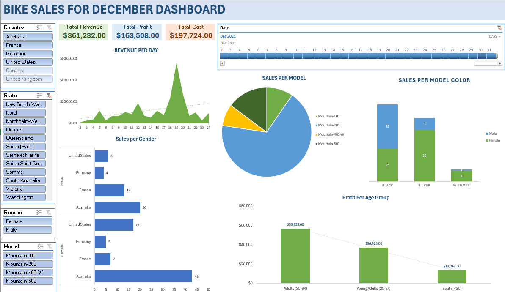

# Cisco Data Analytics Labs

Hands-on labs and a capstone dashboard completed as part of the **Cisco Data Analytics** coursework. The projects use a bike sales dataset to practice the core data analyst workflow in Excel: **preparing, cleaning, manipulating, analyzing, and visualizing data**.



## Table of Contents

- [Overview](#overview)
- [Skills Demonstrated](#skills-demonstrated)
- [Repository Contents](#repository-contents)
- [Lab Summaries](#lab-summaries)
- [Dashboard](#dashboard)
- [Getting Started](#getting-started)
- [Tools](#tools)

## Overview

This repository documents my progress through a series of data analytics labs. Each lab builds on the previous one, starting with raw, messy sales records and ending with a consolidated dataset and a dashboard that summarizes December bike sales.

## Skills Demonstrated

- Data cleaning and preparation (removing duplicates, fixing formatting, handling blanks and inconsistencies)
- Sorting and filtering data
- Data manipulation (text, date, and number handling)
- Excel formulas and functions
- Pivot tables and summary analysis
- Consolidating multiple data sources into one dataset
- Building a dashboard for reporting and insights

## Repository Contents

| File | Description |
|------|-------------|
| `3.4.6_Lab_Preparing_Data.html` | Lab instructions: Preparing Data |
| `Cleaning_Bike_Sales_Lab_3.4.6.xlsx` | Workbook for the data cleaning lab |
| `Bike_Sales_Sort_Lab_4.1.2.csv` | Dataset for the sorting lab |
| `4.2.7_Lab_Manipulate_Data.html` | Lab instructions: Manipulate Data |
| `Bike_Sales_Manipulate_Lab_4.2.7.xlsx` | Workbook for the data manipulation lab |
| `4.3.3_Lab_Formulas_and_Functions.html` | Lab instructions: Formulas and Functions |
| `Bike_Sales_Functions_Lab.xlsx` | Workbook for the formulas and functions lab |
| `4.3.8_Lab_Pivot_tables.html` | Lab instructions: Pivot Tables |
| `Bike_Sales_Pivot_Lab.xlsx` | Workbook for the pivot table lab |
| `Bike_Sales_2021.xlsx` | Bike sales data for 2021 |
| `Bike_Sales_2022.xlsx` | Bike sales data for 2022 |
| `BikeSales_Consolidated.xlsx` | Combined sales dataset |
| `BikeSaleforDecDashboard.png` | Screenshot of the December bike sales dashboard |

## Lab Summaries

### 3.4.6 – Preparing Data
Cleaned a raw bike sales dataset so it was ready for analysis, addressing data quality issues such as duplicates, inconsistent entries, and formatting problems.

### 4.1.2 – Sorting Data
Sorted and organized the bike sales records to make patterns easier to see.

### 4.2.7 – Manipulating Data
Transformed and reshaped data using Excel's data manipulation tools to prepare it for calculation and analysis.

### 4.3.3 – Formulas and Functions
Applied Excel formulas and functions to calculate values and derive new fields from the sales data.

### 4.3.8 – Pivot Tables
Built pivot tables to summarize sales and compare performance across categories.

### Consolidation and Dashboard
Combined the 2021 and 2022 sales files into `BikeSales_Consolidated.xlsx` and used the results to build a December bike sales dashboard.

## Dashboard

The final dashboard visualizes bike sales for December. See [`BikeSaleforDecDashboard.png`](BikeSaleforDecDashboard.png) for a preview, or open `BikeSales_Consolidated.xlsx` to explore the underlying data.

## Getting Started

1. Clone the repository:
   ```bash
   git clone https://github.com/tracyyy19/CiscoDataAnalytics.git
   cd CiscoDataAnalytics
   ```
2. Open the lab instruction files (`.html`) in any web browser.
3. Open the matching `.xlsx` or `.csv` file in Microsoft Excel (or a compatible tool such as Google Sheets or LibreOffice Calc) to follow along.

## Tools

- Microsoft Excel (formulas, pivot tables, charts)
- CSV / XLSX data formats

## Author

**Tracy** – [@tracyyy19](https://github.com/tracyyy19)

## Acknowledgments

Labs and datasets are based on the Cisco Networking Academy Data Analytics curriculum.
